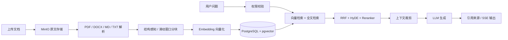
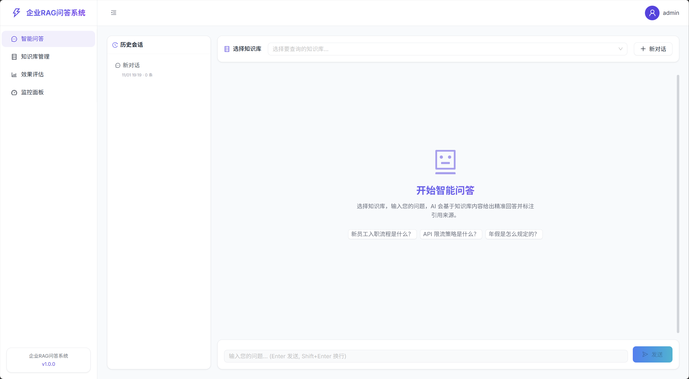
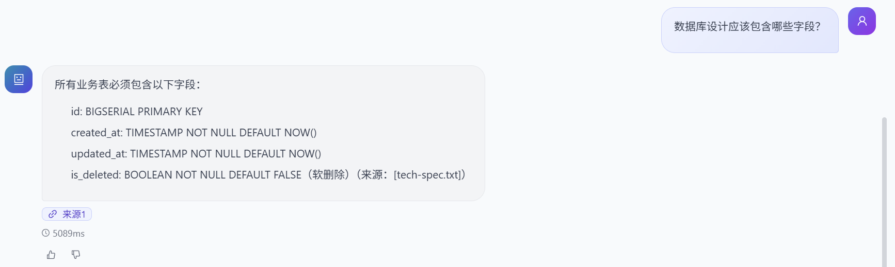
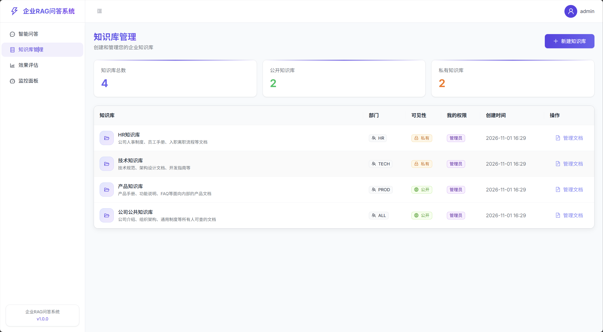
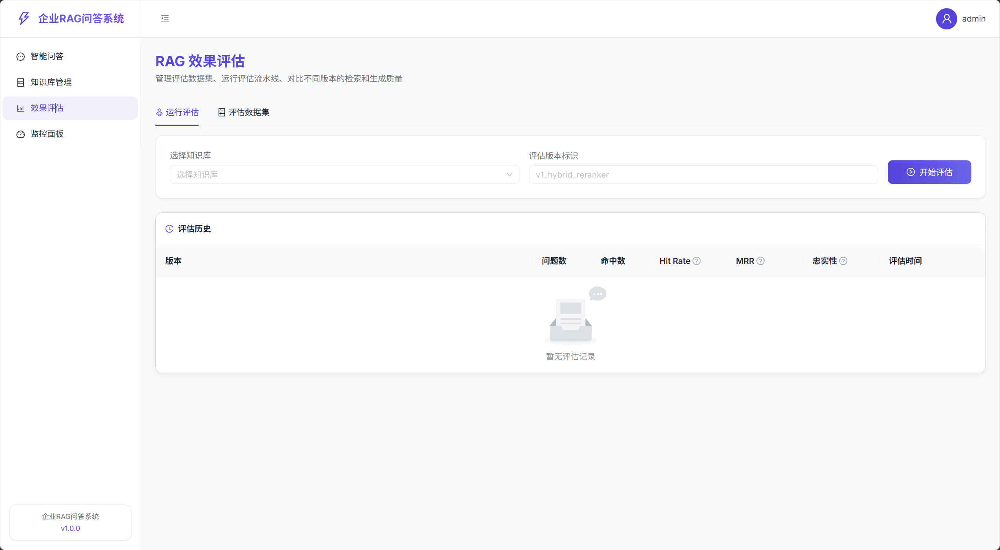
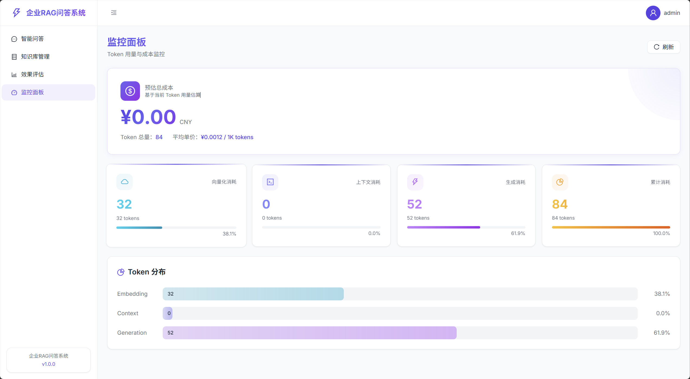

# RAG Knowledge Base

## 1. 项目介绍

RAG Knowledge Base 是一套面向企业知识管理场景的智能问答系统，覆盖知识库管理、文档解析与索引、混合检索、RAG 问答、引用溯源、质量评估和 Token 成本监控等完整流程。

项目采用前后端分离架构：

- **后端**：Java 21、Spring Boot 3.5、Spring AI、PostgreSQL/pgvector、Redis、MinIO
- **前端**：React 18、TypeScript、Vite、Ant Design、AntV
- **模型服务**：通过 OpenAI 兼容接口接入 Chat Model 和 Embedding Model，并支持独立 Reranker API

系统将原始文档保存到 MinIO，解析并切分后生成向量写入 PostgreSQL/pgvector；问答阶段综合向量检索、全文检索、HyDE 和 Reranker，从知识库中召回相关内容，并生成带引用来源的回答。



## 2. 功能

### 知识库与权限管理

- 创建和查询公开、私有知识库
- 用户与部门级 READ、WRITE、ADMIN 权限控制
- Sa-Token 登录认证与 Redis 登录状态持久化
- 文档上传、下载、删除、状态查询和索引重建

### 文档解析与索引

- 支持 PDF、DOCX、Markdown、TXT 四种文档格式
- 保留页码、章节标题等文档结构信息
- 支持结构感知分块和滑动窗口分块
- 异步执行解析、分块、Embedding 和批量向量入库
- 支持失败重试、索引状态追踪和版本化重建
- Redis 缓存 Embedding，减少重复模型调用

### 检索与智能问答

- pgvector 向量检索
- PostgreSQL 全文检索与 Jieba 中文分词
- RRF 混合检索结果融合
- HyDE 查询增强
- Reranker 精排与超时降级
- 置信度过滤和上下文 Token 预算控制
- 同步问答与 SSE 流式回答
- 多轮会话和历史消息持久化
- 回答引用来源解析与文档溯源
- 点赞、点踩和文本反馈

### 效果评估与监控

- 管理评估问题、期望答案和期望 Chunk
- 计算 Hit Rate、MRR 和 Faithfulness
- 保存不同版本的评估结果并进行历史对比
- 统计 Embedding、Context、Generation Token 消耗
- 估算模型调用成本
- 提供 Actuator 健康检查和 Prometheus 指标

## 3. 演示

### 智能问答

用户可以选择一个或多个知识库发起问题，系统支持历史会话和流式回答。



### 引用溯源与回答反馈

回答会关联实际文档来源，并展示响应耗时，用户可以对回答进行点赞或点踩。



### 知识库管理

统一管理不同部门的公开和私有知识库，以及当前用户拥有的访问权限。



### RAG 效果评估

维护评估数据集、运行指定版本的评估流水线，并查看历史评估指标。



### Token 与成本监控

分别统计向量化、上下文和回答生成阶段的 Token 消耗与参考成本。



## 4. 环境配置要求和启动方法

### 环境要求

| 环境 | 推荐版本或说明 |
| --- | --- |
| JDK | 21 |
| Maven | 3.9+ |
| Node.js | 20+ |
| npm | 10+ |
| PostgreSQL | 15+，需要安装 pgvector 扩展 |
| Redis | 6+ |
| MinIO | 用于存储原始文档 |
| Chat / Embedding API | OpenAI 兼容接口 |
| Reranker API | 默认按 DashScope `gte-rerank` 接入 |

### 1. 克隆项目

```bash
git clone https://github.com/x-Achan/RAG-KnowledgeBase.git
cd RAG-KnowledgeBase
```

### 2. 初始化 PostgreSQL

创建数据库：

```sql
CREATE DATABASE ragkb;
```

连接到 `ragkb` 后，依次执行：

```text
src/main/resources/db/schema.sql
src/main/resources/db/data.sql
```

`schema.sql` 会创建 pgvector 扩展、数据表、HNSW 向量索引、全文检索索引和触发器。数据库用户需要具备创建扩展的权限。

### 3. 准备 Redis 和 MinIO

启动 Redis 和 MinIO，并在 MinIO 中创建 Bucket：

```text
rag-documents
```

Bucket 名称也可以通过 `MINIO_BUCKET` 修改。

### 4. 配置后端环境变量

项目提供了可公开上传的 `application.yaml` 和 `.env.example`。复制模板生成只保存在本地的 `.env`：

Windows PowerShell：

```powershell
Copy-Item .env.example .env
```

macOS / Linux：

```bash
cp .env.example .env
```

打开 `.env`，至少填写：

```dotenv
DB_PASSWORD=your-postgres-password
MINIO_ACCESS_KEY=your-minio-access-key
MINIO_SECRET_KEY=your-minio-secret-key
OPENAI_API_KEY=your-model-api-key
EMBEDDING_API_KEY=your-model-api-key
RERANKER_API_KEY=your-model-api-key
```

后端启动时会自动加载项目根目录下的 `.env`。该文件已经被 `.gitignore` 忽略，不应提交到 GitHub。

> `kb_doc_chunk.embedding` 使用 `VECTOR(1024)`，Embedding 模型必须输出 1024 维向量。默认配置对应 DashScope `text-embedding-v3`。

### 5. 启动后端

```bash
mvn spring-boot:run
```

也可以在 IntelliJ IDEA 中直接运行：

```text
src/main/java/com/ccy/ragkb/RagKbApplication.java
```

后端默认地址：

```text
http://localhost:8080
```

### 6. 配置并启动前端

```bash
cd frontend
```

Windows PowerShell：

```powershell
Copy-Item .env.example .env
npm ci
npm run dev
```

macOS / Linux：

```bash
cp .env.example .env
npm ci
npm run dev
```

前端默认地址：

```text
http://localhost:3000
```

前端会将 `/api` 请求代理到 `VITE_API_PROXY_TARGET`，默认后端地址为 `http://localhost:8080`。

### 7. 演示账号

当前登录接口使用内置演示账号，密码均为 `demo123`：

| 账号 | 部门 | 角色 |
| --- | --- | --- |
| `hr001` | HR | MEMBER |
| `tech001` | TECH | MEMBER |
| `admin` | ALL | ADMIN |

生产环境应将演示登录替换为数据库用户体系、企业 SSO 或 LDAP。

## 5. 仓库目录结构简要介绍

```text
RAG-KnowledgeBase/
├── frontend/                       # React + TypeScript 前端项目
│   ├── public/                     # 前端静态资源
│   ├── src/
│   │   ├── api/                    # 后端 API 请求封装
│   │   ├── layout/                 # 页面整体布局
│   │   ├── pages/                  # 问答、知识库、评估、监控页面
│   │   ├── store/                  # Zustand 状态管理
│   │   └── types/                  # TypeScript 类型定义
│   ├── .env.example                # 前端环境变量模板
│   ├── package.json                # 前端依赖和脚本
│   └── vite.config.ts              # Vite 与开发代理配置
├── src/
│   ├── main/java/com/ccy/ragkb/
│   │   ├── config/                 # Spring AI、Redis、MinIO 等配置
│   │   ├── controller/             # REST API 控制器
│   │   ├── dto/                    # 请求与响应对象
│   │   ├── entity/                 # JPA 领域实体
│   │   ├── repository/             # 数据访问与检索 SQL
│   │   ├── security/               # 登录拦截器和用户上下文
│   │   └── service/
│   │       ├── loader/             # PDF、DOCX、Markdown、TXT 解析器
│   │       └── splitter/           # 文档分块策略
│   ├── main/resources/
│   │   ├── application.yaml        # 公共配置和环境变量占位符
│   │   └── db/                     # 数据库结构与初始化数据
│   └── test/                       # 后端测试代码
├── docs/
│   ├── images/                     # README 系统截图
│   └── RAG企业知识库/              # RAG 核心流程设计文档
├── .env.example                    # 后端环境变量模板
├── .gitignore                      # Git 忽略规则
├── pom.xml                         # Maven 项目配置
└── README.md                       # 项目说明
```
